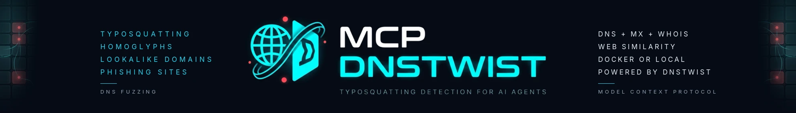
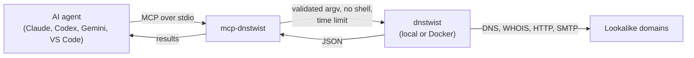

<p align="center">
  
</p>

<p align="center">
  <a href="https://www.npmjs.com/package/@burtthecoder/mcp-dnstwist"></a>
  <a href="https://github.com/w0h1v/mcp-dnstwist/actions/workflows/ci.yml"></a>
  <a href="LICENSE"></a>
  
  <a href="https://registry.modelcontextprotocol.io"></a>
  <a href="https://smithery.ai/server/@burtthecoder/mcp-dnstwist"></a>
</p>

<p align="center">
  <a href="#quickstart">Quickstart</a> ·
  <a href="#the-tool">Tool</a> ·
  <a href="#security">Security</a> ·
  <a href="#troubleshooting">Troubleshooting</a> ·
  <a href="https://w0h1v.github.io/mcp-dnstwist/">Docs</a>
</p>

**mcp-dnstwist** is an [MCP](https://modelcontextprotocol.io) server that lets AI agents run [dnstwist](https://github.com/elceef/dnstwist) to find domains that imitate yours: typos, homoglyphs, bit flips, swapped TLDs and more. For each registered lookalike it can report DNS records, whether its mail server could intercept your email, WHOIS registration details, and how closely its web page copies yours.

> [!NOTE]
> Independent project, not affiliated with dnstwist. Only scan domains you own or are authorized to assess.

> [!IMPORTANT]
> Versions up to 1.0.4 have a command injection vulnerability ([GHSA-p4jr-h3rj-2rw4](https://github.com/w0h1v/mcp-dnstwist/security/advisories/GHSA-p4jr-h3rj-2rw4)) and are deprecated. Use 1.0.5 or later; `npx -y @burtthecoder/mcp-dnstwist` always fetches the latest.

## Highlights

- **Lookalike discovery.** All of dnstwist's permutation algorithms, or only the ones you pick.
- **Threat signals.** DNS records, open mail relays that could intercept email (`mxcheck`), WHOIS creation date and registrar, HTTP and SMTP banners, and web-page similarity (ssdeep or TLSH) to spot cloned phishing sites.
- **Runs your way.** A local dnstwist install, the official dnstwist Docker image, or a self-contained mcp-dnstwist image.
- **Hardened.** No shell, strict input validation, and time limits that stop and clean up long scans.
- **Tested.** End-to-end tests with fake `docker` and `dnstwist` executables run in CI on Node 20, 22 and 24.

## How it works



## Quickstart

**Requirements:** Node.js 20.3 or newer, and either dnstwist (`pipx install "dnstwist[full]"`) or Docker. No API key.

```sh
# Claude Code
claude mcp add --transport stdio dnstwist -- npx -y @burtthecoder/mcp-dnstwist

# Codex CLI
codex mcp add dnstwist -- npx -y @burtthecoder/mcp-dnstwist

# Gemini CLI
gemini mcp add dnstwist npx -y @burtthecoder/mcp-dnstwist
```

For Claude Desktop, VS Code, Docker, Smithery and running from source, see [Connect a client](docs/clients.md).

Then ask your agent: *"Which lookalike domains of example.com are registered, and could any of them intercept email?"* More prompts are in [example workflows](docs/examples.md).

## The tool

One tool, `fuzz_domain`. Full parameters and real sample output are in the [tool reference](docs/tools.md).

| Parameter | Default | What it does |
|---|---|---|
| `domain` | *(required)* | The domain to imitate, for example `example.com` |
| `registered_only` | `true` | Only return lookalikes that exist |
| `fuzzers` | all | Limit to some algorithms, for example `["homoglyph", "bitsquatting"]` |
| `mxcheck` | `true` | Flag mail servers that would accept email for any address |
| `banners` | `true` | Capture HTTP and SMTP banners |
| `whois` | `false` | Registration date and registrar |
| `lsh` | off | Web-page similarity to the original: `ssdeep` or `tlsh` |
| `all_records` | `false` | All DNS records, not only the first of each type |
| `nameservers` | `1.1.1.1` | Up to 10 IPv4 addresses or `https://<host>/dns-query` URLs |
| `threads` | `50` | Parallel lookups, 1 to 100 |
| `format` | `json` | `json`, `csv` or `list` |

### Settings

| Variable | Default | Description |
|---|---|---|
| `DNSTWIST_RUNNER` | `auto` | `local` (dnstwist on `PATH`), `docker` (the `elceef/dnstwist` image), or `auto` (local if available) |
| `DNSTWIST_TIMEOUT_SECONDS` | `600` | Longest a scan may run. On timeout, cancellation or shutdown the scan is stopped and cleaned up |

## Security

The tool's arguments come from an AI model, which content it reads can steer, so the server treats them as hostile:

- **No shell.** dnstwist starts with `execFile` and an argument array; a test fails the build if a shell-based API appears.
- **Strict validation.** Domains must be hostnames, nameservers IPv4 or DoH URLs, numbers and names from fixed sets. No value can start with `-`.
- **Bounded runs.** Time limits, and cleanup of processes and containers on timeout, cancellation and shutdown.

The Docker runner needs access to the Docker daemon (root-equivalent on most systems). The local runner or the self-contained image avoid that. Details in the [security model](docs/security.md). Report vulnerabilities privately; see [SECURITY.md](SECURITY.md).

## Troubleshooting

- **"Neither dnstwist nor Docker is available":** install dnstwist (`pipx install "dnstwist[full]"`) or start Docker. Desktop clients may not see your shell's `PATH`.
- **Slow on Apple Silicon:** the dnstwist Docker image is amd64-only. Install dnstwist locally; it's used automatically.
- **"did not finish within N seconds":** include an IPv4 nameserver (DNS-over-HTTPS is slow), turn off `whois`, `lsh` or `banners`, or raise `DNSTWIST_TIMEOUT_SECONDS`.

More in the [troubleshooting guide](docs/troubleshooting.md).

## Development

```sh
git clone https://github.com/w0h1v/mcp-dnstwist && cd mcp-dnstwist
npm ci
npm test    # fake docker and dnstwist executables: no Docker or network needed
```

See [CONTRIBUTING.md](CONTRIBUTING.md) and the [changelog](CHANGELOG.md).

## License

MIT. See [LICENSE](LICENSE).
